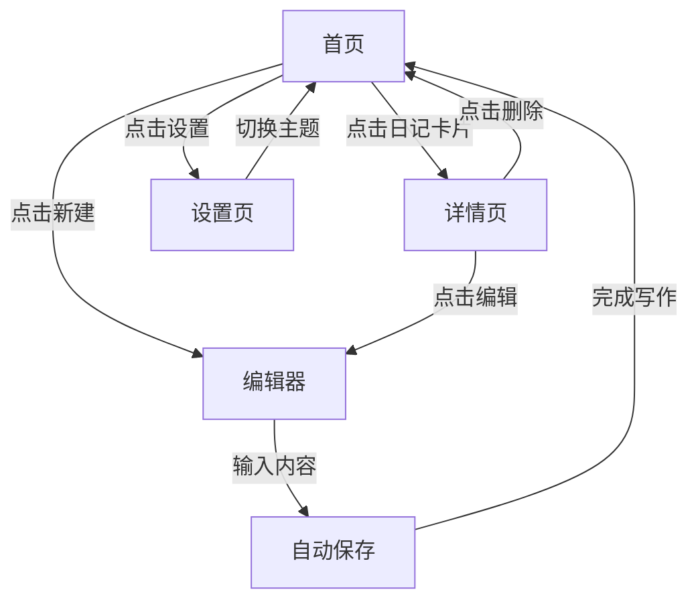

# 静语 - 个人日记工具产品需求文档

## 1. 产品概述

「静语」是一款极简主义风格的个人日记工具，旨在为用户创造一个宁静、专注的写作空间。不同于功能堆砌的传统日记应用，我们追求的是「少即是多」的设计理念——每一个界面元素都为沉浸式写作体验服务。

产品核心价值：
- **宁静专注**：摒弃一切干扰，让思绪自由流淌
- **仪式感**：将写日记变成一种每日的心灵仪式
- **私密安全**：本地优先，数据完全属于用户
- **诗意美学**：东方禅意与现代极简的融合

目标用户：追求内心平静、重视生活仪式感的都市人群，以及希望通过写作进行自我反思和成长的用户。

## 2. 核心功能

### 2.1 用户角色

| 角色 | 使用方式 | 核心权限 |
|------|----------|----------|
| 访客 | 无需注册，直接使用 | 浏览、创建、编辑、删除日记 |
| 注册用户 | 邮箱注册（可选） | 数据云端同步（未来功能） |

### 2.2 功能模块

1. **首页/日记列表**：展示所有日记条目，按时间倒序排列
2. **日记编辑器**：全屏沉浸式写作界面
3. **日记详情查看**：阅读已保存的日记内容
4. **设置面板**：主题切换、字体偏好、数据导出

### 2.3 页面详情

| 页面名称 | 模块名称 | 功能描述 |
|---------|----------|----------|
| 首页 | 日记卡片列表 | 展示日记标题、日期、预览文字；支持点击进入详情或编辑 |
| 首页 | 今日心情 | 首页顶部显示当天的日记状态和心情标签 |
| 首页 | 新建日记按钮 | 悬浮按钮，点击进入编辑器 |
| 编辑器 | 标题输入 | 大字号输入框，支持自动保存 |
| 编辑器 | 正文编辑 | Markdown富文本编辑器，支持基础格式 |
| 编辑器 | 心情标签 | 选择当日心情（平静/愉悦/忧伤/焦虑/感恩等） |
| 编辑器 | 天气标签 | 选择当日天气（晴/雨/阴/雪等） |
| 编辑器 | 字数统计 | 实时显示写作字数 |
| 编辑器 | 保存状态 | 显示自动保存状态 |
| 详情页 | 日记内容 | 展示完整的日记阅读视图 |
| 详情页 | 操作栏 | 编辑、删除、分享（生成分享图片） |
| 设置页 | 主题切换 | 浅色/深色/墨色三套主题 |
| 设置页 | 字体大小 | 小/中/大 三档可调 |
| 设置页 | 数据管理 | 导出JSON格式日记数据 |
| 设置页 | 关于页面 | 应用介绍和版本信息 |

## 3. 核心流程

### 3.1 日记创建流程

```
用户点击「新建」 → 进入编辑器 → 输入标题 → 书写内容 → 选择心情/天气标签 → 自动保存 → 完成
```

### 3.2 日记查看流程

```
用户浏览首页列表 → 点击日记卡片 → 进入详情页 → 阅读内容 → 返回/编辑/删除
```

### 3.3 流程图



## 4. 用户界面设计

### 4.1 设计风格

**设计理念：东方禅意 × 现代极简**

我们追求的不是冷冰冰的极简，而是一种「温暖的克制」——如同精心布置的茶室，每一件物品都有其存在的意义。

**配色方案：**

| 主题 | 主色 | 背景色 | 强调色 | 文字色 |
|------|------|--------|--------|--------|
| 浅色（晨曦） | #E8DED1 | #FAF8F5 | #C4A77D | #3D3A36 |
| 深色（月夜） | #2A2832 | #1A1820 | #9B8AA3 | #E8E4ED |
| 墨色（水墨） | #1E2124 | #0F1112 | #7C8B8F | #D4D0C8 |

**字体选择：**
- 标题字体：`Noto Serif SC`（中文衬线，典雅端庄）
- 正文字体：`LXGW WenKai`（中文手写体，温馨亲切）
- 英文辅助：`Cormorant Garamond`（优雅古典）

**按钮风格：**
- 圆角矩形，半透明毛玻璃效果
- 悬停时微微上浮，伴随柔和的阴影过渡
- 关键操作使用强调色点缀

**图标风格：**
- 使用线性图标，线条流畅优雅
- 保持图标与文字的视觉平衡

### 4.2 页面设计概览

**首页布局：**
- 顶部：应用名称「静语」+ 设置入口
- 中部：日记卡片列表，采用瀑布流或单栏布局
- 底部右下角：新建日记悬浮按钮
- 卡片展示：日期（特殊排版）、心情图标、标题、预览文字
- 留白充足，呼吸感强

**编辑器布局：**
- 全屏沉浸式，顶部保留返回按钮
- 标题区域与正文区域有明显区分
- 底部工具栏：心情、天气、字数统计
- 柔和的背景纹理或渐变

**详情页布局：**
- 类似阅读书籍的版式
- 居中的内容区域，最大宽度限制以保证阅读舒适度
- 顶部显示日期和心情天气信息
- 底部操作栏：编辑、删除、分享

### 4.3 响应式策略

- **桌面端**：双栏布局，左侧列表右侧预览
- **平板端**：单栏布局，底部导航
- **移动端**：全屏单页交互，滑动切换视图
- 触摸优化：大按钮、充足间距、手势支持

## 5. 交互细节与动效

### 5.1 微交互设计

| 交互场景 | 动效描述 |
|----------|----------|
| 点击新建按钮 | 按钮缩放 + 页面渐入 |
| 日记卡片悬停 | 轻微上浮 + 阴影加深 |
| 保存成功 | 右上角轻量提示，无打断 |
| 删除日记 | 滑出动画 + 确认对话框 |
| 主题切换 | 全局颜色渐变过渡（300ms） |
| 页面切换 | 交叉淡化过渡 |

### 5.2 加载状态

- 首次加载：骨架屏展示卡片轮廓
- 数据为空：诗意插图 + 引导文案「今天还没有记录，点击开始书写吧」
- 保存中：编辑器底部显示「正在保存...」

## 6. 数据存储

- **本地存储**：使用 IndexedDB 存储日记数据，支持大量文本
- **数据格式**：每篇日记包含 `id`, `title`, `content`, `mood`, `weather`, `createdAt`, `updatedAt`
- **隐私优先**：所有数据存储在用户本地，不上传任何服务器

## 7. 未来扩展（暂不实现）

- 云端同步
- 多设备登录
- 密码锁定
- AI写作助手
- 导出为PDF/打印
- 心情趋势图表
