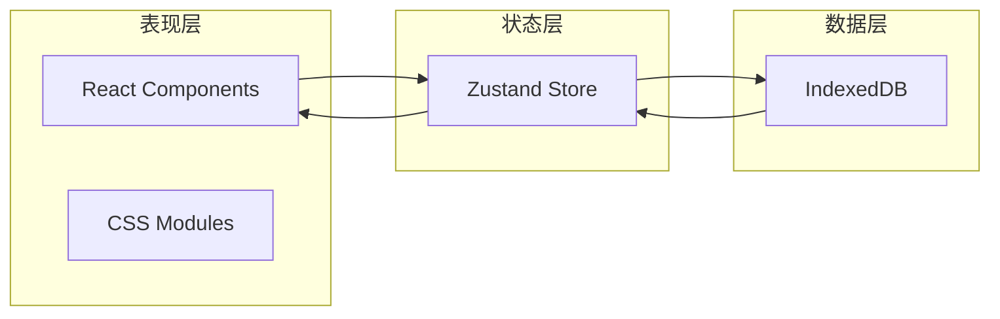

# 静语 - 技术架构文档

## 1. 架构设计

本应用采用**单页应用（SPA）**架构，前端完全独立运行，无需后端服务器。



**架构特点：**
- 纯前端实现，数据完全存储在本地
- 使用 Zustand 进行状态管理，轻量且简洁
- IndexedDB 提供大容量本地存储
- 响应式设计，支持多端访问

## 2. 技术选型

| 技术 | 版本 | 用途 |
|------|------|------|
| React | 18.x | UI框架 |
| TypeScript | 5.x | 类型安全 |
| Vite | 5.x | 构建工具 |
| Zustand | 4.x | 状态管理 |
| Dexie.js | 3.x | IndexedDB封装 |
| React Router | 6.x | 路由管理 |
| Lucide React | 最新 | 图标库 |
| date-fns | 3.x | 日期处理 |

## 3. 路由定义

| 路由 | 页面 | 功能描述 |
|------|------|----------|
| `/` | 首页 | 日记列表展示 |
| `/editor` | 编辑器 | 创建新日记 |
| `/editor/:id` | 编辑器 | 编辑已有日记 |
| `/detail/:id` | 详情页 | 查看日记内容 |
| `/settings` | 设置页 | 应用设置 |

## 4. 组件结构

```
src/
├── components/
│   ├── Layout/
│   │   ├── Header.tsx          # 顶部导航
│   │   └── FloatingButton.tsx  # 悬浮按钮
│   ├── Diary/
│   │   ├── DiaryCard.tsx       # 日记卡片
│   │   ├── DiaryList.tsx       # 日记列表
│   │   ├── MoodSelector.tsx    # 心情选择器
│   │   └── WeatherSelector.tsx # 天气选择器
│   ├── Editor/
│   │   ├── EditorToolbar.tsx   # 编辑器工具栏
│   │   └── WordCounter.tsx     # 字数统计
│   └── Common/
│       ├── Modal.tsx           # 模态框
│       └── Toast.tsx           # 轻量提示
├── pages/
│   ├── HomePage.tsx            # 首页
│   ├── EditorPage.tsx          # 编辑器页
│   ├── DetailPage.tsx          # 详情页
│   └── SettingsPage.tsx        # 设置页
├── stores/
│   ├── diaryStore.ts           # 日记数据状态
│   └── settingsStore.ts        # 设置状态
├── db/
│   └── index.ts                # IndexedDB配置
├── hooks/
│   ├── useDiary.ts             # 日记操作hook
│   └── useAutoSave.ts          # 自动保存hook
├── styles/
│   ├── variables.css           # CSS变量
│   └── global.css              # 全局样式
└── utils/
    ├── date.ts                 # 日期工具
    └── export.ts               # 数据导出
```

## 5. 数据模型

### 5.1 日记数据模型

```typescript
interface Diary {
  id: string;           // UUID
  title: string;       // 标题
  content: string;     // 正文内容（Markdown格式）
  mood: MoodType;      // 心情标签
  weather: WeatherType; // 天气标签
  createdAt: number;   // 创建时间戳
  updatedAt: number;   // 更新时间戳
}

type MoodType = 'peaceful' | 'happy' | 'sad' | 'anxious' | 'grateful' | 'excited' | 'tired' | 'neutral';

type WeatherType = 'sunny' | 'cloudy' | 'rainy' | 'snowy' | 'windy' | 'stormy';
```

### 5.2 设置数据模型

```typescript
interface Settings {
  theme: 'light' | 'dark' | 'ink';  // 主题
  fontSize: 'small' | 'medium' | 'large'; // 字体大小
}
```

## 6. IndexedDB 数据表设计

**数据库名称**：`jingyu-diary`

**表结构：**

| 表名 | 字段 | 类型 | 说明 |
|------|------|------|------|
| diaries | id | string (PK) | 日记唯一标识 |
| diaries | title | string | 标题 |
| diaries | content | string | 正文内容 |
| diaries | mood | string | 心情标签 |
| diaries | weather | string | 天气标签 |
| diaries | createdAt | number | 创建时间 |
| diaries | updatedAt | number | 更新时间 |

**索引**：
- `createdAt`：按创建时间倒序查询

## 7. 状态管理设计

### 7.1 Diary Store

```typescript
interface DiaryStore {
  diaries: Diary[];
  currentDiary: Diary | null;
  isLoading: boolean;
  
  // Actions
  loadDiaries: () => Promise<void>;
  getDiary: (id: string) => Promise<Diary | null>;
  createDiary: (data: Partial<Diary>) => Promise<Diary>;
  updateDiary: (id: string, data: Partial<Diary>) => Promise<void>;
  deleteDiary: (id: string) => Promise<void>;
}
```

### 7.2 Settings Store

```typescript
interface SettingsStore {
  theme: 'light' | 'dark' | 'ink';
  fontSize: 'small' | 'medium' | 'large';
  
  // Actions
  setTheme: (theme: Theme) => void;
  setFontSize: (size: FontSize) => void;
}
```

## 8. 主题系统

### 8.1 主题变量

```css
/* 浅色主题（晨曦） */
:root[data-theme="light"] {
  --color-primary: #E8DED1;
  --color-bg: #FAF8F5;
  --color-accent: #C4A77D;
  --color-text: #3D3A36;
  --color-text-secondary: #6B6560;
  --color-border: #E0D8D0;
  --color-card: #FFFFFF;
  --color-hover: #F5F2EF;
}

/* 深色主题（月夜） */
:root[data-theme="dark"] {
  --color-primary: #2A2832;
  --color-bg: #1A1820;
  --color-accent: #9B8AA3;
  --color-text: #E8E4ED;
  --color-text-secondary: #A09AA8;
  --color-border: #3A3840;
  --color-card: #252330;
  --color-hover: #323040;
}

/* 墨色主题（水墨） */
:root[data-theme="ink"] {
  --color-primary: #1E2124;
  --color-bg: #0F1112;
  --color-accent: #7C8B8F;
  --color-text: #D4D0C8;
  --color-text-secondary: #8A8680;
  --color-border: #2A2D30;
  --color-card: #181B1C;
  --color-hover: #242829;
}
```

## 9. 自动保存机制

- 编辑器开启后，每 **3 秒**检测内容变化
- 如有变化，自动保存到 IndexedDB
- 保存时显示「保存中」状态
- 保存成功后显示「已保存」提示，3秒后消失
- 离开页面时自动保存

## 10. 数据导出

支持导出为 JSON 格式：
```json
{
  "exportDate": "2024-01-15T10:30:00Z",
  "totalCount": 42,
  "diaries": [...]
}
```

导出文件命名格式：`静语日记_YYYYMMDD_HHmmss.json`
